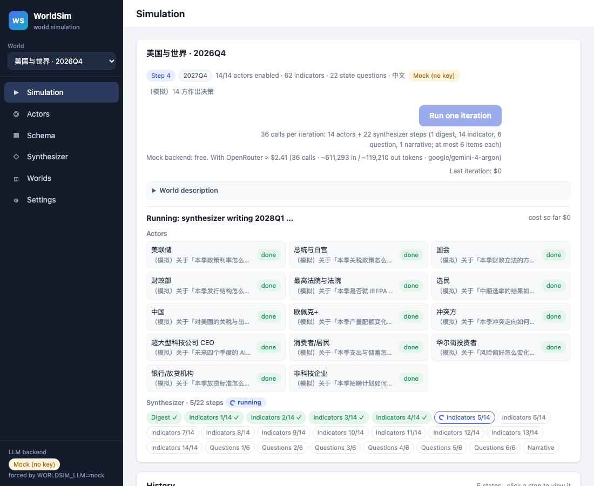

# WorldSim

A small local world simulation driven by LLMs. You describe a world, the state it starts in and the actors in it;
each click on **Run one iteration** moves the world one step: every actor decides, and a synthesizer writes the next
state in the same shape.

No pricing model and no charts: WorldSim is world simulation only. Prices (an index, gold, house prices) are simply
fields of the state, moved by the synthesizer with everything else.



## How it works

```
world description (fixed) ─┐
input state ────────────────┼─► every actor answers its decision questions (+ autonomous actions), in parallel
(indicators, question       │                │
 statuses, narrative)       │                ▼
        ▲                   └─► synthesizer, step by step: digest → indicators (≤ x per call) → questions (≤ x)
        │                                                    → narrative (~100 字)
        └──────────────── output state: the same shape (one click = one step) ◄┘
```

- **World description**: fixed text on what the world is and what one step means, shown to every model call.
- **State**: a value for every **indicator** (typed fields: number, percent, integer, enum, boolean, text), a
  natural-language **status** for every **predefined state question**, and a ~100-字 **narrative** summarizing it all.
- **Actors**: a role, what they care about, private information, a few **decision questions** answered in text every
  step, and optional **autonomous actions** they choose themselves.
- **Synthesizer**: multi-shot. It writes a digest of the period, then the indicators in chunks of at most *x*
  (default 6), then the question statuses in chunks of at most *x*, then the narrative. Each call answers only its own
  items, so each gets the model's full attention. A step that fails keeps its items from the previous state and marks
  the iteration *partial*.
- **Resume after a crash**: every answered actor and finished synthesizer step is saved at once; if the server
  stops mid-iteration, or a refused key or empty credits pause it, **Resume** calls only what is left.
- **Audit view**: for every actor and every synthesizer step, attempt by attempt (repairs and retries included), the
  exact input sent (messages, request settings, the answer's JSON schema), the model's thinking as the provider
  returned it, and the raw and parsed output with the app's verdict. Thinking is only what the provider returns:
  Gemini returns summaries of its reasoning, some models return none, and encrypted reasoning cannot be read.

Everything is configurable in the browser: actors, the schema (indicators and state questions), the synthesizer, the
model per world, actor or synthesizer, and the OpenRouter key.

## Run it

Python 3.10+.

```bash
git clone https://github.com/Dongyu-Jia/worldsim.git
cd worldsim
pip install -e ".[dev]"
python -m worldsim                    # http://127.0.0.1:8940
```

Open http://127.0.0.1:8940. The first start creates the preloaded world 「美国与世界 · 2026Q4」 (fourteen actors, 62
indicators, 22 state questions; one quarter per step).

- **With a key**: Settings → OpenRouter API key → paste your `sk-or-v1-…` key (https://openrouter.ai/keys). The default
  model is `anthropic/claude-haiku-5.5` (cheap and fast); any OpenRouter model id can be picked or typed, for
  example `google/gemini-4-argon` for deeper reasoning at about 20 times the price.
- **Without a key**: choose *Mock (no key)* in Settings, or start with `WORLDSIM_LLM=mock python -m worldsim`. The mock
  is free and deterministic; it exercises the mechanics, not the economics.

The Simulation page shows the number of calls and an estimated cost before you run. The default world makes 36 calls
per iteration (14 actors + 22 synthesizer steps); raising *x* on the Synthesizer page means fewer, larger calls.

## Your key

- Stored only on your machine, in `settings.json` in the data folder (`data/` in a checkout, `~/.worldsim` when
  installed), with file mode 0600.
- Sent only to `openrouter.ai`. The browser only ever sees it masked; it never appears in logs, prompts, saved
  iterations or exports.
- The server binds 127.0.0.1 and accepts state-changing requests only from its own pages.

## The default world

「美国与世界 · 2026Q4」 is a US-centred political-economy world at the start of 2026Q4: the Fed, the White House,
Congress, the Treasury, the courts, voters, China, OPEC+, the parties to a conflict, big-tech CEOs, households, Wall
Street investors, banks and non-tech firms. Its numbers were built from the local data of
[Causeway](https://github.com/Dongyu-Jia/causeway) and each field's description cites its source and date. Facts that
were not confirmed are tagged 未确认, and estimated prices are tagged 估算. Treat it as a starting point to edit, not as
a forecast.

## Documentation

[docs/WORLDSIM.md](docs/WORLDSIM.md) covers the iteration step by step, the failure handling, the pages, storage,
models and cost, the default world's sources, the JSON API and the limits.

## Tests

```bash
pytest -q
ruff check worldsim tests
```

The tests run on the mock backend or a fake HTTP transport; no test can reach openrouter.ai or needs a key.

## License

MIT, see [LICENSE](LICENSE).
